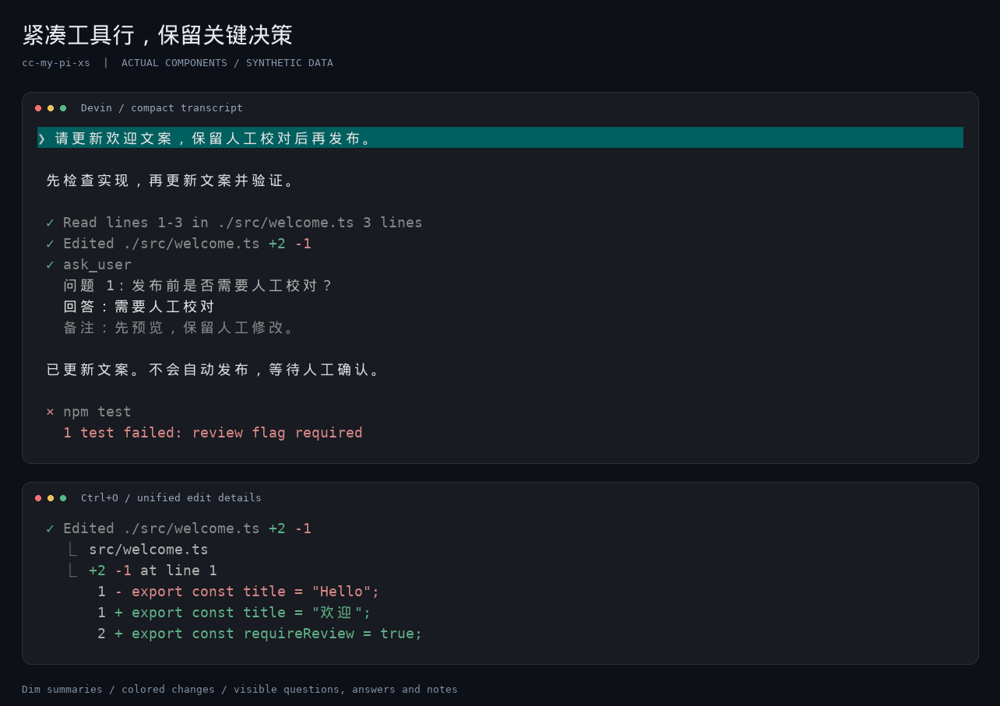
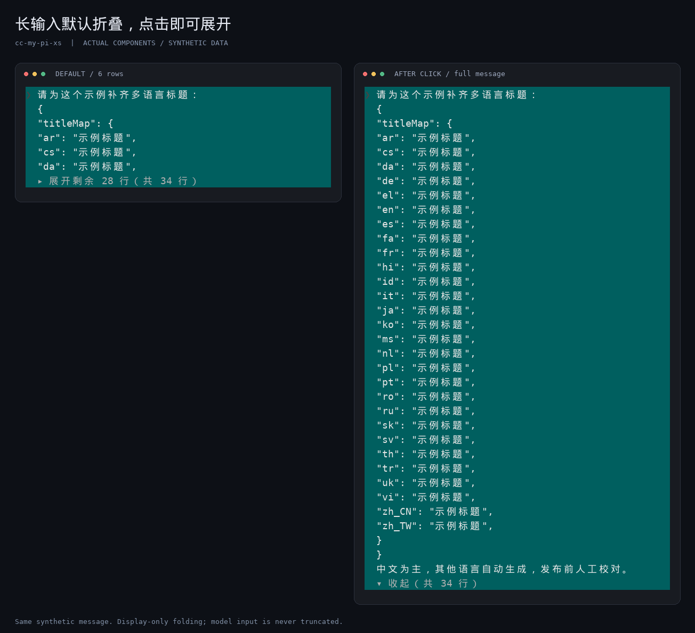
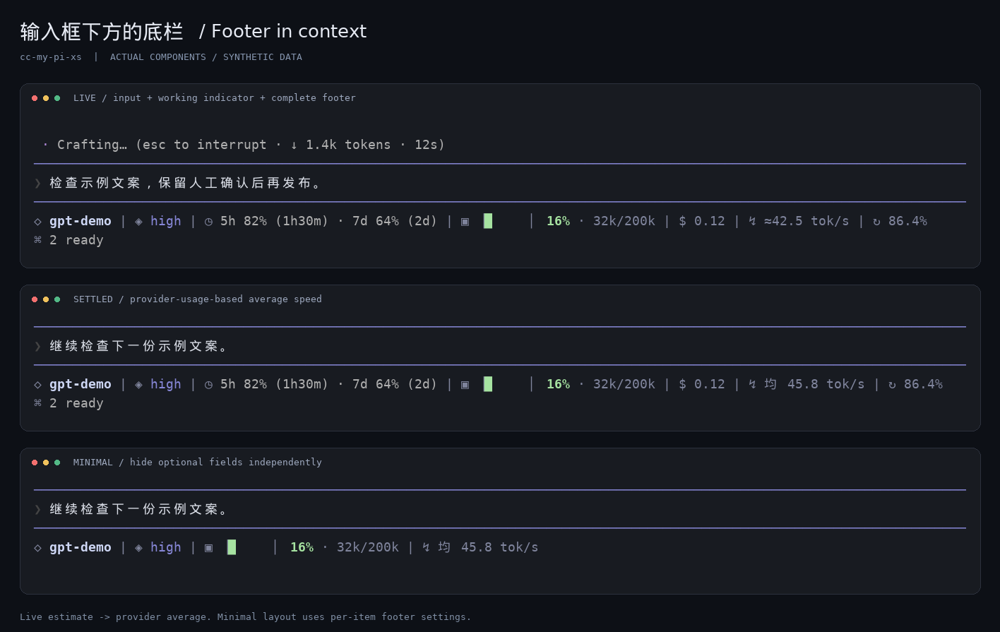
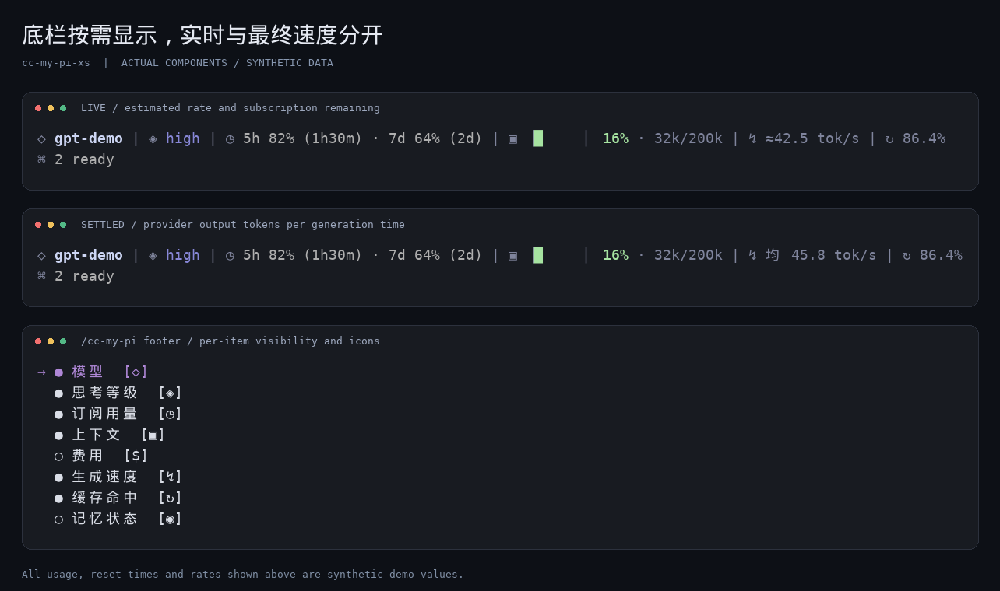

# cc-my-pi-xs

[简体中文](README.md) | **English**

A personal UI fork for [Pi](https://pi.dev): **compact conversations, expandable long inputs, readable question-and-answer records, and a configurable footer.**

Based on [cc-my-pi 1.4.3](https://github.com/timvdhoorn/cc-my-pi/tree/v1.4.3). It retains the original Claude-style mode and adds an optional Devin-style compact view. **Installing this package does not automatically switch to Devin mode.**

## Preview

These PNGs use **synthetic files, questions, input text, and usage data rendered through actual Pi and extension components**. They are not production-session screenshots or terminal recordings. Fonts and antialiasing may differ from your terminal. Click an image to view it at full size.

### Compact tools and decision records



Consecutive tools have no blank rows between them; text/tool boundaries get one blank row. Tool summaries are dimmed, while success, failure, and edit counts keep their colors. Completed `ask_user` calls show questions, final answers, and notes by default, rather than just a tool name.

### Long inputs do not overwhelm the transcript



Sent user messages exceeding **8 rendered rows** default to a **6-row** preview with a clickable expand/collapse control. **Only the display is folded; the full message still reaches the model.** The controls currently use Chinese labels.

### Input area and footer in context



The three panels show synthetic examples of:

- **Live generation:** the separate `Crafting…` indicator above the input, and a footer below it with model, thinking level, subscription remaining/reset time, context, cost, `≈` live speed, cache hit rate, and MCP status.
- **After generation:** the working indicator ends, and speed changes to `均 … tok/s`—the provider-usage-based average. Other footer information remains available.
- **Minimal configuration:** optional subscription, cost, cache, and extension fields are hidden individually, leaving model, thinking level, context, and speed. This does not change generation or telemetry.

| Default icon | Field | Meaning |
| --- | --- | --- |
| `◇` | Model | Model ID without an additional provider prefix |
| `◈` | Thinking | The current model's thinking level |
| `◷` | Codex subscription | Remaining percentage and reset countdown supplied by pi-usage |
| `▣` | Context | Usage percentage and used tokens / context window |
| `$` | Cost | Accumulated provider cost for the current session branch |
| `↯` | Speed | Live estimate `≈`; provider-usage-based average `均` after generation |
| `↻` | Cache | Cache-read share of the latest assistant request; omitted when cache data is unavailable |
| `⌘`, etc. | Extension status | MCP, memory, background-terminal, and other supported status providers |

### Footer controls and metric details



The separate workspace-path / Git-branch row is hidden. Use `/cc-my-pi footer` to change each item's visibility and icon independently. These components target **Pi's terminal TUI**; web clients do not automatically inherit them.

## What changes compared with upstream?

| Area | This fork |
| --- | --- |
| Optional Devin mode | One-line tool summaries and consistent left margins; no gaps between consecutive tools, one blank row at text boundaries; original Claude mode and saved preferences remain available |
| Tool summaries | Dim actions, commands, paths, and line counts; Read shows returned ranges/counts; Edit shows colored additions/deletions; multiline shell commands show the first line and remaining-line count |
| Thinking placeholders | In Devin mode, hides all collapsed inline `Thinking...` rows and their empty space; keeps the separate bottom working animation; Ctrl+T still reveals reasoning |
| Long user messages | In Devin mode, messages over 8 rendered rows fold to 6; click controls and keyboard commands expand them without changing source text, session records, or model context |
| `ask_user` details | In Devin mode, shows questions, submitted answers, and question/option notes by default; omits unselected options; a setting disables automatic details while Ctrl+O still expands them |
| Edit diffs | Deletion-before-addition unified output with red/green text; avoids unnecessary backgrounds, borders, and ANSI-padding blank rows at narrow widths |
| Footer controls | Per-item visibility and Unicode icons through `/cc-my-pi footer` or the settings panel |
| Codex usage | Reuses optional pi-usage status for remaining percentages and reset countdowns; no additional account requests |
| Model label | Removes the extra provider prefix, not suffixes belonging to the model ID |
| Token speed | `≈… tok/s` live estimates; `均 … tok/s` final averages calculated from provider output tokens and generation duration |
| Tasks | Retains cc-my-pi 1.4.3 behavior; no added task folding, footer task counts, or editor navigation |
| Packaging and validation | Includes the added runtime modules and type declarations, fixes unavailable test paths, and adds focused customization regression tests |

**Scope:** no changes to inference requests or model-facing content, no changes to the pi-ask plugin itself, and no removal of normal mode. Devin preserves internal Markdown paragraph/code-block spacing rather than deleting every blank line. Font size remains controlled by the terminal.

## Installation

Requires Pi and **Node.js 22.18+**. The full interaction path was checked against Pi **1.4.0**, and the development dependencies also cover Pi **0.84.4**. Click interactions require fullscreen mouse routing; keyboard commands provide a fallback in regular mode.

```bash
pi install git:github.com/xing-shuai/cc-my-pi-xs
```

Then run `/reload` in Pi or restart Pi.

- **Do not load this package alongside** `npm:cc-my-pi` or another local cc-my-pi copy: they modify the same UI components.
- If an older copy is configured, remove its package entry first; do not delete your personal configuration.
- This fork **is not published to npm**. Do not use `pi install npm:cc-my-pi-xs`. The `private: true` flag prevents accidental npm publication and does not block Git installation.
- A fresh installation may open the upstream setup wizard. You can skip it and configure the package later through `/cc-my-pi`.

### Local development installation

```bash
git clone https://github.com/xing-shuai/cc-my-pi-xs.git
cd cc-my-pi-xs
npm ci --omit=dev --ignore-scripts
```

Add the clone's **absolute path** to the existing `packages` array in `~/.pi/agent/settings.json`, without replacing your other entries:

```json
{
  "packages": ["/absolute/path/to/cc-my-pi-xs"]
}
```

This is only a minimal package-entry example. Reload Pi after editing extension source, and use `git pull` to update your local clone. This fork does not replace itself through the upstream npm update prompt.

## Usage and settings

```text
/cc-my-pi                   Open settings with a live preview
/cc-my-pi footer            Configure footer item visibility and icons
/cc-my-pi user expand       Expand long user messages in the current transcript
/cc-my-pi user collapse     Collapse long user messages in the current transcript
/cc-my-pi status            Show tool UI settings
```

1. **Enable compact mode:** `/cc-my-pi` → **Conversation style** → `devin`.
2. **Disable automatic question details:** `/cc-my-pi` → **Ask User details** → `off`. Set it back to `on` to restore them.
3. **Tool details:** Ctrl+O. It also reveals questions and answers when automatic details are disabled.
4. **Reasoning:** Ctrl+T. Hiding placeholders does not delete reasoning records.
5. **Long messages:** click the expand/collapse control, or use the `user` commands above when mouse routing is unavailable. Ctrl+O does not control user-message folding.

Switching back to `claude` restores that mode's tool framing/grouping preferences. Devin does not overwrite them.

This English README describes the existing UI; it does **not** change the language of controls. Some custom settings, question-result labels, footer labels, and the final-speed prefix `均` remain Chinese. Here, `均` means “average.”

### Configuration locations

| File | Purpose |
| --- | --- |
| `~/.pi/agent/settings.json` | Pi package entries, terminal mode, and native settings |
| `~/.pi/settings.json` | Inherited cc-my-pi-xs UI configuration; project `./.pi/settings.json` can override it |
| `~/.pi/agent/cc-my-pi-footer.json` | Footer item `enabled` / `icon` values; created on the first edit |
| `~/.pi/agent/pi-usage.json` | Optional pi-usage configuration, not bundled or overwritten by this fork |

Names remain compatible with upstream and existing configurations. **The repository does not contain your personal configuration files.**

For example, explicitly select Devin and enable question details:

```json
{
  "conversationStyle": "devin",
  "devinAskUserDetails": true
}
```

When unset, `conversationStyle` defaults to `claude` and `devinAskUserDetails` defaults to `true`. Question-detail customization applies only to Devin mode.

### Optional: Codex remaining usage

Install/configure [pi-usage](https://www.npmjs.com/package/@narumitw/pi-usage) separately. The footer reads its published `usage` status; it does not install pi-usage, copy authentication, or make duplicate account requests. These pi-usage settings select remaining usage and countdowns:

```json
{
  "codexStatusPercentage": "remaining",
  "codexStatusResetCountdown": true
}
```

Missing usage data is shown as a placeholder, not a fabricated percentage. Percentages, countdowns, costs, and speeds in the preview images are synthetic.

### What the speed numbers mean

- **Live:** estimates tokens from text, thinking, and tool-argument deltas over a trailing 2-second window; updates every 250ms and decays during pauses. `≈` means an estimate, not an exact server-side decode rate.
- **After generation:** provider output tokens divided by aggregate generation duration, including first-token wait but excluding tool-execution gaps. The `均` prefix identifies this average.
- The tracker is adapted from [pi-open-tui 0.4.3](https://github.com/OldSuns/pi-open-tui), with its MIT notice retained. This package does not install that project's entire UI.

## Development checks

```bash
npm ci --ignore-scripts
npm test
npm run typecheck
npm run pack:dry-run
```

`npm test` runs one centralized customization regression suite and the original Tasks tests. Coverage includes summaries, question details, long-message folding, thinking placeholders, wide characters and terminal widths, mode fallback, token telemetry, and configuration defaults. It is not an end-to-end test of every optional upstream extension. Mouse behavior, fonts, and animation can still vary between terminals.

Set `PI_TEST_HOST` to another Pi export entry to run the same tests against a different host. The tests use host-module mapping, like Pi's extension loader, to avoid component-class mismatches from duplicate peer dependencies.

## Attribution and license

- [cc-my-pi 1.4.3](https://github.com/timvdhoorn/cc-my-pi/tree/v1.4.3): Tim van den Hoorn; [upstream documentation](https://github.com/timvdhoorn/cc-my-pi/blob/v1.4.3/README.md).
- Original [pi-cc-tools / pi-claude-code-ui](https://github.com/FammasMaz/pi-cc-tools): FammasMaz.
- Vendored Tasks, queue-steer, header, Esc components, and telemetry sources are documented in [VENDOR.md](VENDOR.md).
- MIT; original copyright and license notices are retained. See [LICENSE](LICENSE).

Devin / Claude refer only to interface design inspiration, not official affiliation with those products. See [CHANGELOG.md](CHANGELOG.md) for version history.
