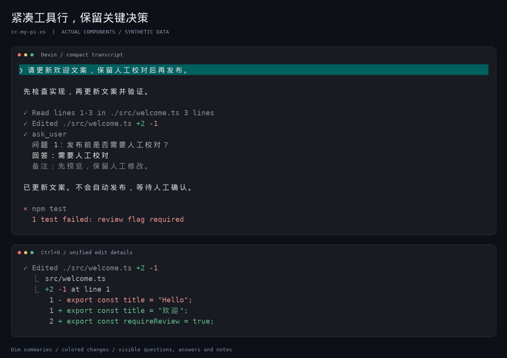
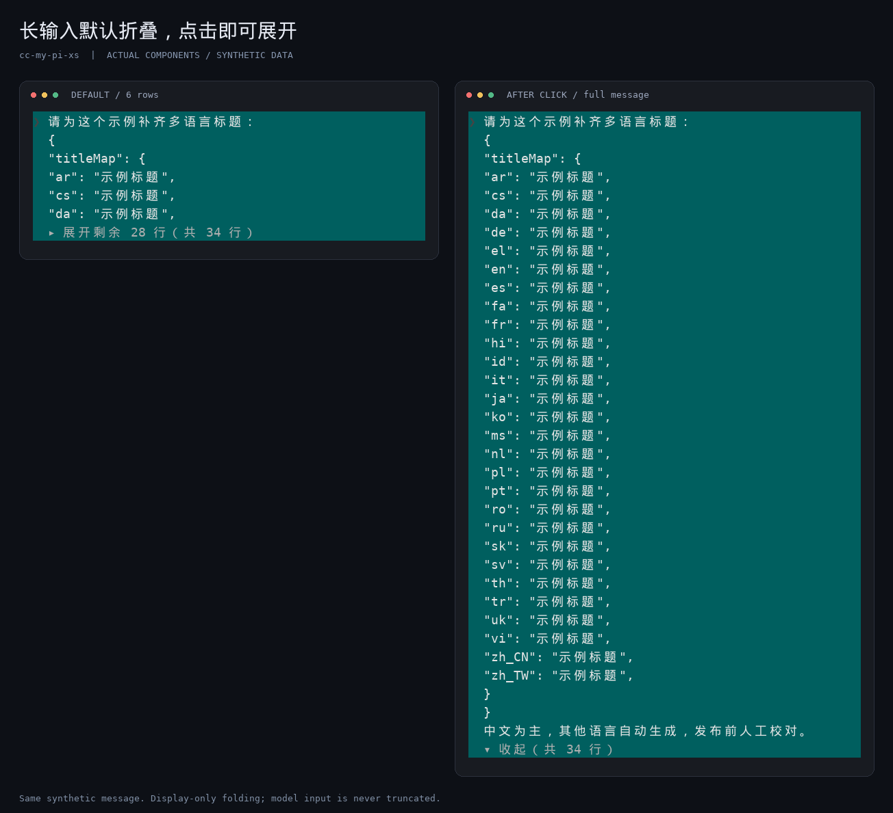
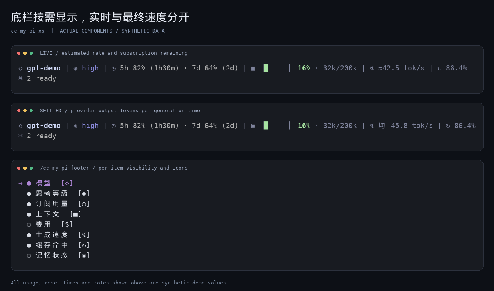

# cc-my-pi-xs

给 [Pi](https://pi.dev) 的个人定制 UI：**对话更紧凑、长输入可折叠、问答结果可回看、底栏可配置。**

基于 [cc-my-pi 1.4.3](https://github.com/timvdhoorn/cc-my-pi/tree/v1.4.3) 的独立定制版，保留 Claude 风格入口，额外提供可选的 Devin 紧凑模式。**不会安装后自动切换到 Devin。**

> English: A personal fork of cc-my-pi with optional Devin-style compact conversations, expandable long user messages, visible ask_user decisions, configurable footer icons, and live/final token-rate telemetry. Install from Git; this fork is not published to npm.

## 看效果

以下 PNG 使用**虚构的文件、问答与用量数据，调用实际 Pi/本插件组件渲染后制图**。不是业务会话截图，也不是终端录屏；字体与抗锯齿可能和你的终端不同。点击图片可查看原图。

### 紧凑工具行与问答记录



连续工具不插空行；正文和工具块间留一行。工具摘要调暗，但成功、失败与增删数量保留颜色。`ask_user` 默认展示问题、最终回答与备注，而不是只剩一个工具名。

### 长输入不会淹没对话



超过 **8 个显示行**的用户消息，默认显示前 **6 行**及“展开剩余 N 行”。点击展开或收起。**只折叠显示，不裁剪模型接收的原文。**

### 底栏与实时速度



不再单独显示工作区路径 / Git 分支行。模型、思考等级、订阅用量、上下文、费用、速度、缓存及扩展状态均可单独隐藏或修改图标。

## 相对上游增加 / 调整了什么

| 部分 | 本定制版的行为 |
| --- | --- |
| 可选 Devin 模式 | 单行工具摘要，统一左边距；连续工具零空行，正文边界一空行；保留原 Claude 模式与原设置 |
| 工具摘要 | 动作、命令、路径和行数统一暗灰；Read 显示返回行数 / 范围；Edit 显示红绿增删数；多行命令显示首行与剩余行数 |
| 思考占位 | Devin 中隐藏所有对话内 `Thinking...` 占位及对应空白，只保留底部独立运行中动效；Ctrl+T 仍可查看真实思考 |
| 长用户消息 | Devin 中超过 8 个显示行默认折叠为前 6 行；可点击展开 / 收起，支持键盘命令；完整文本、会话和模型上下文不变 |
| `ask_user` 详情 | Devin 中默认输出问题、最终回答及问题 / 选项备注；不重复列出未选选项；可在设置中关闭，Ctrl+O 仍能临时展开 |
| 编辑 Diff | 使用先删除、后新增的 unified 布局，红绿文本；避免不必要的背景、边框与窄窗口 ANSI 填充空白行 |
| 图标化 footer | 独立控制每项显隐与图标，默认 Unicode；通过 `/cc-my-pi footer` 或设置页管理 |
| Codex 订阅用量 | 复用可选 pi-usage 提供的状态，展示剩余百分比与重置倒计时；本插件不另行请求账号接口 |
| 模型名 | 不重复添加 provider 前缀，保留模型 ID 本身的后缀 |
| 生成速度 | 生成中为 `≈… tok/s` 实时估计；结束后为 `均 … tok/s`，使用 provider 输出 token 与生成时长计算 |
| Tasks | 保留 cc-my-pi 1.4.3 的原有任务行为；不新增任务折叠、底栏任务计数或编辑器导航 |
| 发布完整性 | 补全新增模块的打包清单与类型声明，修复 npm 包中不存在测试路径的验证入口，补充本定制版回归测试 |

**没有改动的边界：** 不改推理请求或模型内容，不修改 pi-ask 原插件；常规模式仍可用。Devin 正文内部继续遵循 Markdown 段落 / 代码块间距，并非把所有空行都删掉。终端字号仍由终端统一控制。

## 安装

需要 Pi，以及 Node.js **22.18+**。完整交互路径在 Pi **1.4.0** 上验证；本地开发依赖同时覆盖 Pi **0.84.4**。鼠标点击需要支持事件路由的 fullscreen 模式；普通模式可用键盘命令。

```bash
pi install git:github.com/xing-shuai/cc-my-pi-xs
```

然后在 Pi 中运行 `/reload`，或重启 Pi。

- **不要同时加载** `npm:cc-my-pi`、另一个 cc-my-pi 本地副本和本仓库：它们都修改相同的 UI 组件。
- 如已配置旧副本，先从 Pi 的包列表移除对应旧条目；不要删除个人配置。
- 本仓库 **未发布 npm**，请勿使用 `pi install npm:cc-my-pi-xs`。`private: true` 用于防止误发布 npm，不影响 Git 安装。
- 新安装可能弹出上游首次设置向导，可跳过，之后用 `/cc-my-pi` 随时调整。

### 本地开发安装

```bash
git clone https://github.com/xing-shuai/cc-my-pi-xs.git
cd cc-my-pi-xs
npm ci --omit=dev --ignore-scripts
```

把克隆目录的**绝对路径加入** `~/.pi/agent/settings.json` 已有的 `packages` 数组，不要覆盖其他包：

```json
{
  "packages": ["/absolute/path/to/cc-my-pi-xs"]
}
```

上面只是包条目的最小示例。修改扩展源码后需要 `/reload`；本地 Git 副本更新使用 `git pull`。本 fork 不使用上游 npm 更新提示替换自己的代码。

## 使用与设置

```text
/cc-my-pi                   打开设置，带即时预览
/cc-my-pi footer            底栏各项显隐及图标
/cc-my-pi user expand       展开当前对话中的长用户消息
/cc-my-pi user collapse     收起当前对话中的长用户消息
/cc-my-pi status            查看工具 UI 设置
```

1. **启用紧凑模式：** `/cc-my-pi` → **Conversation style** → `devin`。
2. **关闭问答默认详情：** `/cc-my-pi` → **Ask User details** → `off`；再次设为 `on` 即恢复。
3. **工具展开：** Ctrl+O。关闭问答默认详情后，也可通过它临时查看完整问题与回答。
4. **思考原文：** Ctrl+T。隐藏占位不等于删除思考记录。
5. **长消息：** 点击底部“展开剩余 N 行 / 收起”；普通终端无鼠标路由时用上面的 `user` 命令。Ctrl+O 不接管用户消息折叠。

切回 `claude` 会恢复该模式原有的工具 framing / grouping 偏好；Devin 不覆盖保存的这些偏好。

### 配置文件分别在哪里

| 文件 | 用途 |
| --- | --- |
| `~/.pi/agent/settings.json` | Pi 包列表、终端模式及原生设置 |
| `~/.pi/settings.json` | cc-my-pi-xs 继承的 UI 配置位置；项目 `./.pi/settings.json` 可覆盖 |
| `~/.pi/agent/cc-my-pi-footer.json` | 底栏各项的 `enabled` / `icon`，首次修改时保存 |
| `~/.pi/agent/pi-usage.json` | 可选 pi-usage 自己的用量设置，不由本仓库打包或覆盖 |

设置名和文件名保持兼容上游 / 已有个人配置；**本仓库不包含你的这些配置文件**。

例如，明确选择 Devin 并显示问答详情：

```json
{
  "conversationStyle": "devin",
  "devinAskUserDetails": true
}
```

`conversationStyle` 未设置时为 `claude`；`devinAskUserDetails` 未设置时为 `true`，仅在 Devin 模式生效。

### 可选：Codex 剩余用量

需要单独安装 / 配置 [pi-usage](https://www.npmjs.com/package/@narumitw/pi-usage)。底栏直接读取它发布的 `usage` 状态；不额外安装它，不复制认证，不重复发账号请求。可在它的配置里选择：

```json
{
  "codexStatusPercentage": "remaining",
  "codexStatusResetCountdown": true
}
```

没有用量数据时显示占位，而不是伪造百分比。截图中的百分比、倒计时、费用及速度均为演示数据。

### 速度的含义

- **实时：** 近 2 秒窗口，根据文本、思考和工具参数 delta 估计 token；每 250ms 更新，停顿时衰减。`≈` 表示估计值，不是服务端精确解码速率。
- **结束后：** provider 输出 token 数除以累计生成时长，包含首 token 等待、不包含工具执行间隙；以 `均` 区分。
- 统计核心改编自 [pi-open-tui 0.4.3](https://github.com/OldSuns/pi-open-tui)，保留 MIT 许可；没有安装其整套 UI。

## 开发验证

```bash
npm ci --ignore-scripts
npm test
npm run typecheck
npm run pack:dry-run
```

`npm test` 使用一份集中的定制回归测试和原有 Tasks 测试，覆盖摘要、问答详情、长消息折叠、思考占位、宽字符与窗口宽度、模式回退、token 统计及配置默认值。不是对所有上游可选扩展的端到端测试；真实终端的鼠标、字体与动画仍可能因终端而异。

`PI_TEST_HOST` 可指定另一套 Pi 的导出入口，以相同测试核验不同宿主版本。测试使用 Pi 同类的模块映射方式，避免本地重复 peer dependency 造成组件类身份不一致。

## 来源与许可

- [cc-my-pi 1.4.3](https://github.com/timvdhoorn/cc-my-pi/tree/v1.4.3)：Tim van den Hoorn；上游 [使用文档](https://github.com/timvdhoorn/cc-my-pi/blob/v1.4.3/README.md)。
- 原始 [pi-cc-tools / pi-claude-code-ui](https://github.com/FammasMaz/pi-cc-tools)：FammasMaz。
- Tasks、queue-steer、header、Esc 等 vendored 组件及 telemetry 的来源见 [VENDOR.md](VENDOR.md)。
- MIT，保留原作者版权和许可，见 [LICENSE](LICENSE)。

Devin / Claude 仅表示界面设计参考，不代表与相应产品存在官方关联。版本记录见 [CHANGELOG.md](CHANGELOG.md)。
